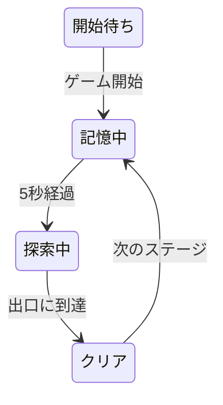

# 残響迷路 基本設計書

| 項目 | 内容 |
|---|---|
| 対象 | 残響迷路（ECHO MAZE） |
| 作成日 | 2026年11月11日 |
| 対象実装 | `dist/index.html`、コミット `0a02799` |
| 利用形態 | ブラウザで遊ぶ1人用の記憶パズル |

## 1. ゲームの目的

迷路の壁が見えている間に道を覚え、壁が消えたあとに、左上のスタートから右下の出口まで移動する。壁にぶつかったときの表示と、壁を一時的に見せる「エコー」を手がかりにできる。

## 2. 画面構成

| 領域 | 表示・操作 |
|---|---|
| ヘッダー | ゲーム名「残響迷路」と英語名「ECHO MAZE」 |
| 迷路盤面 | マス目、壁、ミント色の丸（現在地）、金色のひし形（出口）。盤面下に凡例を表示 |
| プレイ情報 | ステージ番号、歩数、残りエコー回数 |
| 状況メッセージ | 開始案内、壁が消えるまでの秒数、探索案内、壁への衝突、エコー発動、クリア時の歩数 |
| 主ボタン | 「ゲーム開始」「迷路を覚えよう」「探索中」「次のステージ」を進行に合わせて表示 |
| 操作ボタン | エコーと上下左右の方向ボタン。操作方法を併記 |

画面幅が660px以下の場合は盤面と操作欄を縦に並べる。それより広い場合は盤面の右に操作欄を置く。

## 3. プレイの流れ

| 状態 | 壁の見え方 | 操作 |
|---|---|---|
| 開始待ち | 全ての壁が見える | ゲーム開始 |
| 記憶中 | 全ての壁が見える。5秒のカウントダウンを表示 | 移動とエコーは無効 |
| 探索中 | 外周の壁とマス目は常に見える。内側の壁は通常隠れる | 移動、条件を満たす場合はエコー |
| クリア | 全ての壁が見える | 次のステージへ進む |

初回の迷路はページを開いた時点で生成・表示されるため、開始ボタンを押す前にも道を確認できる。次のステージでは、新しい迷路の生成とカウントダウンの開始が同時に行われる。

## 4. ゲームルール

| 項目 | 仕様 |
|---|---|
| 迷路 | ステージ1は5×5。以後1段階ずつ拡大し、ステージ6以降は10×10。進むたびに迷路を生成 |
| 移動 | 矢印キー、WASD、画面の方向ボタンで上下左右に1マス移動。キー長押し時はOS・ブラウザのキーリピートに従う |
| 歩数 | 移動に成功するたびに1加算。壁で阻まれた場合は現在地と歩数を維持 |
| 衝突 | ぶつかった壁を0.35秒間赤く表示 |
| エコー | 各ステージ2回。1回につき1.3秒間すべての壁を表示。表示中も移動可。重ねがけ不可 |
| エコーの入力 | エコーボタン、またはボタン以外にフォーカスがある状態でSpace。ボタンにフォーカスがあるときのSpaceは、そのボタンの標準操作 |
| クリア | 出口のマスへ入るとクリア。クリアまでの歩数を表示 |
| 次のステージ | ステージ番号を1増やし、現在地、歩数、残りエコーを初期化 |

## 5. 実行環境とデータ

HTML・CSS・JavaScriptとCanvas 2Dで動作する。ゲーム中の状態はブラウザのメモリに保持し、ページを再読み込みするとステージ1から始まる。進行状況の保存、アカウント、ランキング、制限時間によるゲームオーバーは現行版の対象外。HTMLをローカルで開いた場合もゲームの処理にネットワーク接続は不要。
